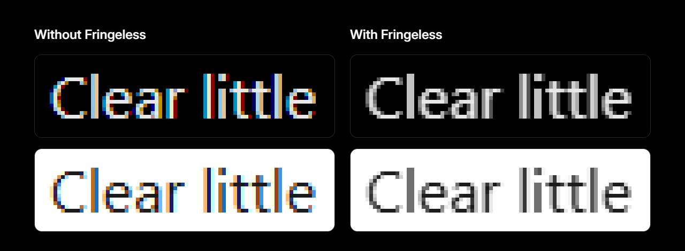
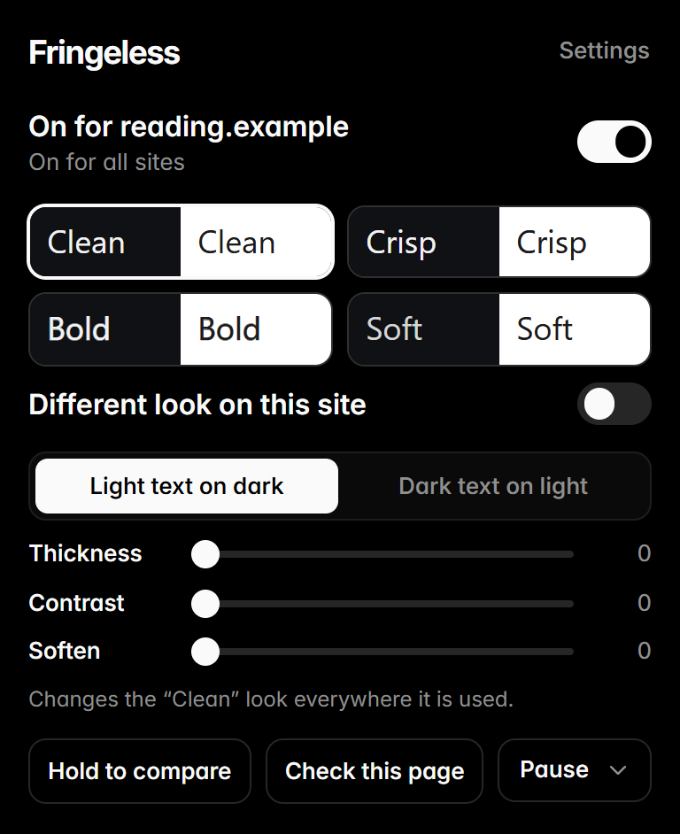
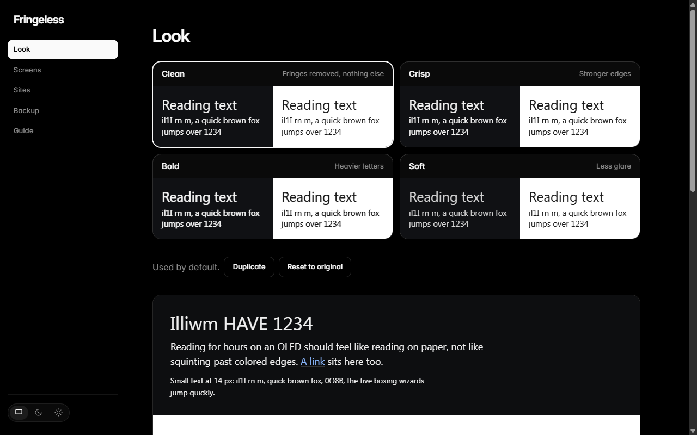
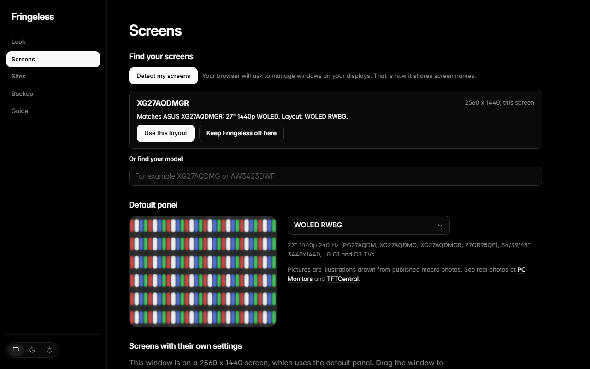

<div align="center">


# Fringeless

**Clearer text for OLED screens**

A browser extension that removes the colored edges around web text on WOLED and QD-OLED screens.

[](https://github.com/iammarxg/fringeless/releases/latest)
[](https://github.com/iammarxg/fringeless/actions/workflows/ci.yml)
[](LICENSE)

[Install](#install) | [Features](#features) | [How it works](#how-it-works) | [Limits](#limits) | [Changelog](CHANGELOG.md)

</div>



<sub>Pixels Chrome sends to the screen on Windows with ClearType on, enlarged. 16 px Segoe UI.</sub>

Windows and browsers smooth text for screens whose subpixels run red, green, blue. OLED panels arrange theirs differently, so that color lands beside the letter. Fringeless makes the browser draw the same text without it, and lets you adjust how heavy and how bright it looks.

## Install

Works in **all Chromium browsers** (Chrome, Edge, Brave, Opera, Vivaldi, Arc and others, version 131 or newer) and in **Firefox** 140 or newer, on Windows, macOS and Linux.

Store listings are being prepared. Until then, download the zip from the [latest release](https://github.com/iammarxg/fringeless/releases/latest).

| Browser | Steps |
|---|---|
| Chromium | Unzip `fringeless-x.y.z-chrome.zip` into a folder you will keep. Open `chrome://extensions`, turn on **Developer mode**, choose **Load unpacked**, and pick the folder. |
| Firefox | Open `about:debugging#/runtime/this-firefox`, choose **Load Temporary Add-on**, and pick `fringeless-x.y.z-firefox.zip`. It stays until Firefox closes. |

A setup page opens, helps you find your screen, and asks for permission to change text on sites. Tabs that were already open may need a reload.

## Features

| | |
|---|---|
|  | **Change it where you read.** Turn it on or off for a site, pick a look, and adjust thickness, contrast and softness separately for light and dark text. Hold a button to compare with the original. **Check this page** counts the colored edge pixels before and after (Chromium). |

- **Looks:** Clean removes the fringes and nothing else. Crisp, Bold and Soft also change the weight or glare. Make your own.
- **Sites:** run everywhere, everywhere except some sites, or only on sites you choose. Wildcards and regular expressions work.
- **Screens:** give each screen its own settings, such as on for the monitor and off for the TV.
- **Detection:** finds your screen's model (Chromium) or lets you search about 400 OLED models. A camera check covers the rest.
- **The rest:** pause for a tab or an hour, keyboard shortcuts, dark and light themes, sync, and backup to a file.

| Looks | Screens |
|---|---|
|  |  |

## Which screens benefit

| Panel | Where you find it | What to expect |
|---|---|---|
| WOLED RWBG | Many 27" 1440p 240 Hz, 34" to 45" 3440x1440, most LG TVs before the G5 | Removes the color from text smoothing |
| WOLED RGWB | 27" 1440p above 240 Hz, 32" 4K, 5K2K ultrawides | Same, with a milder fringe to begin with |
| QD-OLED | 27", 32", 34", 49" | Removes the color from text smoothing. The panel's own green and magenta edges above and below letters remain; the experimental layout filter targets those |
| RGB stripe | 2026 panels with a normal stripe, and LCDs | Little or nothing to fix |

Tested on Windows in Chrome, Edge, Brave and Firefox, and by eye on a WOLED RWBG monitor. Other Chromium browsers share the same engine. Reports from [QD-OLED, RGWB, macOS and Linux](https://github.com/iammarxg/fringeless/issues/new?template=screen_report.yml) are very welcome.

## How it works

- **Chromium:** an invisible overlay with an SVG `backdrop-filter` that changes nothing. Its presence makes the browser draw the text below it in grayscale.
- **Firefox:** `filter: opacity(.9999)` on the page, or a hairline text stroke when extra thickness is on.
- **Looks:** inherited text stroke, shadow and fill color, chosen by whether the text is light or dark.
- **Layout filter** (experimental, off by default, Chromium, QD-OLED and custom panels): resamples each color where its subpixel is.

On the test page this took colored text pixels from 20,394 to 883 in Chrome and from 15,918 to 0 in Firefox, with no element moved. The 883 were inside an embedded frame that this test did not cover; the extension also runs inside frames. Method and numbers: [docs/lab-findings.md](docs/lab-findings.md).

## Limits

An extension cannot change browser menus and tabs, store and settings pages, the built-in PDF viewer, text painted into a canvas or image, or fringes on pictures and icons. macOS already draws text in grayscale, so there only the looks and the layout filter make a difference.

For the rest of Windows, see [Better ClearType Tuner](https://github.com/bp2008/BetterClearTypeTuner) and [MacType](https://github.com/snowie2000/mactype).

## Privacy

No analytics, no servers, no network requests. Settings stay in your browser. See [PRIVACY.md](PRIVACY.md).

## Build

Any OS with Node.js 22 or newer and npm. No other tools are needed.

```sh
npm ci
npm run build:chrome     # .output/chrome-mv3
npm run build:firefox    # .output/firefox-mv3
```

Reviewers: `npm ci && npm run build-for-amo` reproduces the Firefox package. More in [CONTRIBUTING.md](CONTRIBUTING.md).

## License

[GPL-3.0](LICENSE). Credits are in [NOTICE](NOTICE). Not affiliated with any monitor or browser maker, nor with other projects named Fringeless.
